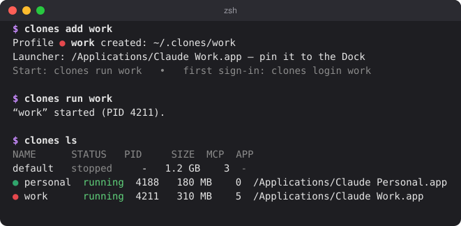

<p align="right"><b>English</b> · <a href="README.ru.md">Русский</a></p>

# clones

**Several Claude Desktop accounts on one Mac, side by side.**

Work, personal, testing: each account opens from its own Dock icon and has its own sign-in,
chats and projects, settings and MCP servers. The profiles know nothing about each other.

<p align="center">
  
</p>

<p align="center">
  <br>
  <sub>Each profile gets its own icon in the Dock.</sub>
</p>

## Install

Copy this block, paste it into Terminal and press Return:

```sh
mkdir -p ~/.local/bin ~/.zfunc
curl -fsSL https://github.com/pmmodlin/clones/releases/latest/download/clones-macos.tar.gz | tar -xz -C ~/.local/bin
grep -qs 'HOME/.local/bin' ~/.zshrc || echo 'export PATH="$HOME/.local/bin:$PATH"' >> ~/.zshrc
grep -qs '.zfunc' ~/.zshrc || echo 'fpath=(~/.zfunc $fpath); autoload -Uz compinit && compinit' >> ~/.zshrc
export PATH="$HOME/.local/bin:$PATH"
clones completion zsh > ~/.zfunc/_clones
clones --version
```

It downloads `clones` into `~/.local/bin`, adds it to your `PATH` and turns on Tab completion in `~/.zshrc`,
then prints the version. Running it again simply updates clones to the latest release.
Works on macOS 13+, Apple silicon and Intel.

<details>
<summary>Downloaded <code>clones-macos.tar.gz</code> from the Releases page in a browser instead?</summary>

```sh
mkdir -p ~/.local/bin ~/.zfunc
tar -xzf ~/Downloads/clones-macos.tar.gz -C ~/.local/bin
xattr -d com.apple.quarantine ~/.local/bin/clones 2>/dev/null; true
grep -qs 'HOME/.local/bin' ~/.zshrc || echo 'export PATH="$HOME/.local/bin:$PATH"' >> ~/.zshrc
grep -qs '.zfunc' ~/.zshrc || echo 'fpath=(~/.zfunc $fpath); autoload -Uz compinit && compinit' >> ~/.zshrc
export PATH="$HOME/.local/bin:$PATH"
clones completion zsh > ~/.zfunc/_clones
clones --version
```

`xattr` clears the “downloaded from the internet” flag that macOS puts on files from a browser.
</details>

<details>
<summary>Build from source</summary>

Needs Apple's developer tools (`xcode-select --install`).

```sh
git clone https://github.com/pmmodlin/clones
cd clones
make install
```
</details>

## Quick start

```sh
clones install          # no Claude Desktop yet? this downloads it from the official site
clones add work         # a profile per account
clones login work       # sign in once
```

Then drag **Claude Work** and **Claude Default** (your regular Claude) from Applications to the Dock,
in place of the old Claude icon. That's all.

You need a Mac administrator account: clones puts the profile icons into Applications.

## Getting started

**1. Create a profile** for each account:

```sh
clones add work
clones add personal
```

“Claude Work” and “Claude Personal” appear in Applications: the Claude icon with a colored letter.
With the first profile you also get **Claude Default**: your regular Claude, as before.

**2. Sign in** to each profile:

```sh
clones login work
```

A Claude window opens; sign in as usual. If other profiles are open, clones closes them while you sign in
and reopens them when you press Enter. The FAQ explains [why](#signing-in-with-google-does-not-finish).

**3. Pin the profiles to the Dock.** Remove the regular Claude icon from the Dock and drag “Claude Default”,
“Claude Work” and “Claude Personal” from Applications to the Dock. That's it: from now on just click the icons.

Why not the regular Claude icon? While profiles are running, clicking Claude.app itself just brings an
arbitrary running profile forward. “Claude Default” always opens your regular Claude.

## Every day

| To do this | Do this |
|---|---|
| Open a profile | Its Dock icon, Spotlight (“Claude Work”) or `clones run work` |
| See what is running | `clones ls` |
| Close a profile | ⌘Q in its window or `clones kill work` |
| Close everything | `clones kill --all` |
| Your regular Claude | “Claude Default” in the Dock or `clones run default` |

A running profile shows its own name in the Dock and in the ⌘Tab switcher, e.g. “Claude Work”.

## MCP servers

Each profile has its own list of MCP servers.

```sh
clones config work                         # open the MCP settings of work
clones kill work && clones run work        # restart so Claude picks them up
clones add test --clone-mcp-from work      # a new profile with the MCP servers of work
```

## FAQ

### Signing in with Google does not finish

With several profiles open, macOS may hand the browser's reply to a different Claude window:
that window shows a sign-in code, and the profile you wanted stays signed out.
So sign in with `clones login <profile>`: while you sign in, it is the only Claude running.

Signing in with the code from the email always works: type the code right into the Claude window.
You only sign in once; the profile remembers it.

The same applies to connectors that authorize through the browser: connect them while only that
profile is open.

### The window flickers when I click the Dock icon

That is expected if you pinned the icon of a running profile instead of dragging it from Applications.
The clones background helper notices such a launch and opens the right profile.

### How do I update Claude?

```sh
clones kill --all
clones update
```

Claude can also update itself. After that, `clones update` brings the profile icons up to the new
version. If something looks off, run `clones doctor`; it tells you what to do.

### What do profiles share?

The account, chats, projects, settings, MCP servers and cache are separate. Only these are shared:

- the Cowork and Claude Code file folders: `~/Documents/Claude`, `~/Claude Projects`;
- the `claude` command in Terminal keeps using the common `~/.claude`. The Code tab inside each
  profile has its own skills, settings and sessions (to share `~/.claude` instead:
  `clones add work --no-isolate-claude-code`);
- Claude's log files.

The “Claude in Chrome” extension connects only to plain Claude (`default`).

Do not sign in to the same account in two profiles; they will get in each other's way.

### Where are my profiles stored?

In `~/.clones/<profile>` (a hidden folder in your home folder; in Finder press ⌘⇧. to show it).
Each profile's Claude Code skills and settings are in `~/.clones/<profile>/claude-config`.
`clones dir work` prints the exact path. Plain Claude (`default`) stays where it always was.

### How do I rename a profile or change its color?

```sh
clones rename work job                     # sign-in and data are kept
clones app job --color '#30A46C'           # a different icon color
```

After renaming, replace the Dock icon with the new one from Applications.

### How do I remove a profile?

```sh
clones rm personal
```

clones asks for confirmation and removes the profile and its icon: the sign-in, settings, MCP servers
and cache of that profile. Your chats live in your Anthropic account and stay there.

### Something is not working

```sh
clones doctor
```

Checks the installation, running profiles and settings, and suggests fixes.

## All commands

| Command | What it does |
|---|---|
| `clones add <name>` | Create a profile and its icon in Applications |
| `clones login <name>` | Sign in to a profile |
| `clones run <name>` | Open a profile (or bring its window forward) |
| `clones ls` | List profiles: which are running, how much space they use |
| `clones kill <name>`, `clones kill --all` | Close a profile or all of them |
| `clones config <name>` | Set up the profile's MCP servers |
| `clones rename <old> <new>` | Rename a profile |
| `clones rm <name>` | Remove a profile |
| `clones app <name>` | Rebuild a profile's icon, change its color (`--color`) or picture (`--icon`) |
| `clones install`, `clones update` | Install or update Claude Desktop |
| `clones doctor` | Check that everything is fine |

Every command has help: `clones <command> --help`.

## Language

clones speaks English, or Russian when macOS is set to Russian. To choose explicitly:
`export CLONES_LANG=en` or `export CLONES_LANG=ru`.

## Uninstall clones

```sh
clones kill --all
clones agent uninstall                                # the background helper
rm -rf ~/.clones                                      # all profiles: sign-ins, settings, MCP, Claude Code
mdfind "kMDItemCFBundleIdentifier == 'dev.clones.launcher.*'" | while read -r a; do rm -rf "$a"; done   # profile icons
rm -f ~/.local/bin/clones ~/.zfunc/_clones           # the clones command and its completion
```

If you like, also remove the two lines the installer added to `~/.zshrc` (`.local/bin` and `.zfunc`).

Plain Claude and its data are not touched.

## Feedback and license

Found a bug or have an idea? [Open an issue](https://github.com/pmmodlin/clones/issues/new/choose);
for bugs, please include the output of `clones doctor`.

clones is released under the [MIT license](LICENSE). It is an independent tool, not made or
endorsed by Anthropic; “Claude” is a trademark of Anthropic.

## More

- [docs/TECHNICAL.md](docs/TECHNICAL.md): how it works, every flag, files, development and tests.
- [docs/RESEARCH.md](docs/RESEARCH.md) (Russian): the Claude Desktop study behind the isolation approach.
