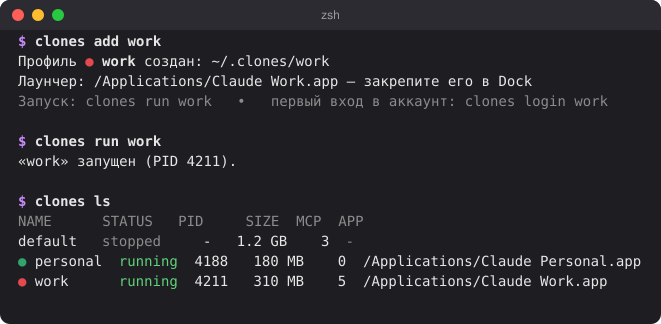

<p align="right"><a href="README.md">English</a> · <b>Русский</b></p>

# clones

**Несколько аккаунтов Claude Desktop на одном Маке — одновременно.**

Рабочий, личный, тестовый: каждый аккаунт открывается своим значком в Dock, и у каждого
свой вход, свои чаты и проекты, свои настройки и MCP-серверы. Друг о друге профили ничего не знают.

<p align="center">
  
</p>

<p align="center">
  <br>
  <sub>У каждого профиля свой значок в Dock.</sub>
</p>

## Установка

Скопируйте этот блок, вставьте в Терминал и нажмите Return:

```sh
mkdir -p ~/.local/bin ~/.zfunc
curl -fsSL https://github.com/pmmodlin/clones/releases/latest/download/clones-macos.tar.gz | tar -xz -C ~/.local/bin
grep -qs 'HOME/.local/bin' ~/.zshrc || echo 'export PATH="$HOME/.local/bin:$PATH"' >> ~/.zshrc
grep -qs '.zfunc' ~/.zshrc || echo 'fpath=(~/.zfunc $fpath); autoload -Uz compinit && compinit' >> ~/.zshrc
export PATH="$HOME/.local/bin:$PATH"
clones completion zsh > ~/.zfunc/_clones
clones --version
```

Блок скачает `clones` в `~/.local/bin`, добавит его в `PATH` и включит дополнение по Tab в `~/.zshrc`,
а в конце покажет версию. Повторный запуск просто обновит clones до последнего релиза.
Работает на macOS 13+, Apple Silicon и Intel.

<details>
<summary>Скачали <code>clones-macos.tar.gz</code> со страницы Releases через браузер?</summary>

```sh
mkdir -p ~/.local/bin ~/.zfunc
tar -xzf ~/Downloads/clones-macos.tar.gz -C ~/.local/bin
xattr -d com.apple.quarantine ~/.local/bin/clones 2>/dev/null; true
grep -qs 'HOME/.local/bin' ~/.zshrc || echo 'export PATH="$HOME/.local/bin:$PATH"' >> ~/.zshrc
grep -qs '.zfunc' ~/.zshrc || echo 'fpath=(~/.zfunc $fpath); autoload -Uz compinit && compinit' >> ~/.zshrc
export PATH="$HOME/.local/bin:$PATH"
clones completion zsh > ~/.zfunc/_clones
clones --version
```

`xattr` снимает пометку «загружено из интернета», которую macOS ставит на файлы из браузера.
</details>

<details>
<summary>Собрать из исходников</summary>

Нужны инструменты разработчика Apple (`xcode-select --install`).

```sh
git clone https://github.com/pmmodlin/clones
cd clones
make install
```
</details>

## Быстрый старт

```sh
clones install          # нет Claude Desktop? скачает его с официального сайта
clones add work         # по профилю на аккаунт
clones login work       # войти один раз
```

Потом перетащите **Claude Work** и **Claude Default** (ваш обычный Claude) из «Программ» в Dock
вместо старого значка Claude. Всё.

Нужна учётная запись администратора Мака: clones кладёт значки профилей в «Программы».

## Первые шаги

**1. Создайте профиль** для каждого аккаунта:

```sh
clones add work
clones add personal
```

В «Программах» появятся «Claude Work» и «Claude Personal» — значок Claude с цветной буквой профиля.
Вместе с первым профилем появится и **Claude Default** — ваш обычный Claude, как раньше.

**2. Войдите в аккаунт** в каждом профиле:

```sh
clones login work
```

Откроется окно Claude — войдите как обычно. Если в это время открыты другие профили, clones
закроет их на время входа, а после нажатия Enter откроет обратно. Почему так — в разделе
«[Вход через Google не завершается](#вход-через-google-не-завершается)».

**3. Закрепите профили в Dock.** Уберите из Dock обычный значок Claude и перетащите туда из «Программ»
«Claude Default», «Claude Work» и «Claude Personal». Готово: дальше просто кликайте по значкам.

Почему не обычный значок Claude? Пока работают профили, клик по самому Claude.app просто покажет
какой-нибудь из уже открытых. «Claude Default» всегда открывает ваш обычный Claude.

## Каждый день

| Что сделать | Как |
|---|---|
| Открыть профиль | Значок в Dock, Spotlight («Claude Work») или `clones run work` |
| Посмотреть, что запущено | `clones ls` |
| Закрыть профиль | ⌘Q в его окне или `clones kill work` |
| Закрыть всё | `clones kill --all` |
| Ваш обычный Claude | «Claude Default» в Dock или `clones run default` |

Запущенный профиль в Dock и в переключателе ⌘Tab подписан своим именем — «Claude Work».

## MCP-серверы

У каждого профиля свой список MCP-серверов.

```sh
clones config work                         # открыть настройки MCP профиля work
clones kill work && clones run work        # перезапустить, чтобы Claude их подхватил
clones add test --clone-mcp-from work      # новый профиль с MCP-серверами из work
```

## Частые вопросы

### Вход через Google не завершается

Когда открыто несколько профилей, macOS может отдать ответ браузера не тому окну Claude:
оно покажет код для входа, а нужный профиль так и останется без входа.
Поэтому входите через `clones login <профиль>`: на время входа он будет единственным открытым Claude.

Вход по коду из письма работает всегда: вводите код прямо в окне Claude.
Входить нужно один раз — профиль запоминает вход.

То же касается подключения коннекторов с авторизацией через браузер: делайте это, когда открыт
только этот профиль.

### При клике по значку в Dock окно на мгновение мигает

Это нормально, если вы закрепили значок уже запущенного профиля, а не перетащили его из «Программ».
Фоновый помощник clones замечает такой запуск и сразу открывает нужный профиль.

### Как обновить Claude

```sh
clones kill --all
clones update
```

Claude умеет обновляться и сам. После такого обновления `clones update` подтянет до новой версии
значки профилей. Если что-то выглядит странно, запустите `clones doctor` — он подскажет, что делать.

### Что общего у всех профилей

Аккаунт, чаты, проекты, настройки, MCP-серверы и кэш у каждого профиля свои. Общие только:

- папки с файлами Cowork и Claude Code: `~/Documents/Claude`, `~/Claude Projects`;
- команда `claude` в Терминале работает с общей папкой `~/.claude`. А вкладка Code в каждом профиле
  со своими скилами, настройками и сессиями (чтобы вместо этого делить `~/.claude`:
  `clones add work --no-isolate-claude-code`);
- журналы работы Claude.

Расширение «Claude in Chrome» подключается только к обычному Claude (`default`).

Не входите в один и тот же аккаунт в двух профилях — они будут мешать друг другу.

### Где лежат профили

В `~/.clones/<профиль>` — это скрытая папка в домашней папке (в Finder её показывает ⌘⇧.).
Скилы и настройки Claude Code профиля — в `~/.clones/<профиль>/claude-config`.
Точный путь печатает `clones dir work`. Обычный Claude (`default`) остаётся там, где был всегда.

### Как переименовать профиль или сменить цвет

```sh
clones rename work job                     # вход и данные сохранятся
clones app job --color '#30A46C'           # другой цвет значка
```

После переименования замените значок в Dock на новый из «Программ».

### Как удалить профиль

```sh
clones rm personal
```

clones спросит подтверждение и удалит профиль вместе со значком: вход, настройки, MCP-серверы
и кэш этого профиля. Чаты хранятся в аккаунте Anthropic и никуда не денутся.

### Что-то работает не так

```sh
clones doctor
```

Проверит установку, запущенные профили и настройки и подскажет, как исправить найденное.

## Все команды

| Команда | Что делает |
|---|---|
| `clones add <имя>` | Создать профиль и его значок в «Программах» |
| `clones login <имя>` | Войти в аккаунт профиля |
| `clones run <имя>` | Открыть профиль (или показать его окно) |
| `clones ls` | Список профилей: какие запущены, сколько места занимают |
| `clones kill <имя>`, `clones kill --all` | Закрыть профиль или все |
| `clones config <имя>` | Настроить MCP-серверы профиля |
| `clones rename <старое> <новое>` | Переименовать профиль |
| `clones rm <имя>` | Удалить профиль |
| `clones app <имя>` | Пересоздать значок профиля, сменить цвет (`--color`) или картинку (`--icon`) |
| `clones install`, `clones update` | Установить или обновить Claude Desktop |
| `clones doctor` | Проверить, всё ли в порядке |

У каждой команды есть подсказка: `clones <команда> --help`.

## Язык

clones говорит по-английски, а если macOS настроена на русский — по-русски. Выбрать явно:
`export CLONES_LANG=ru` или `export CLONES_LANG=en`.

## Удалить clones целиком

```sh
clones kill --all
clones agent uninstall                                # фоновый помощник
rm -rf ~/.clones                                      # все профили: входы, настройки, MCP, Claude Code
mdfind "kMDItemCFBundleIdentifier == 'dev.clones.launcher.*'" | while read -r a; do rm -rf "$a"; done   # значки профилей
rm -f ~/.local/bin/clones ~/.zfunc/_clones           # сама команда clones и автодополнение
```

По желанию уберите и две строки, которые установка добавила в `~/.zshrc` (с `.local/bin` и `.zfunc`).

Обычный Claude и его данные при этом не трогаются.

## Обратная связь и лицензия

Нашли ошибку или есть идея? [Создайте issue](https://github.com/pmmodlin/clones/issues/new/choose);
к ошибке приложите вывод `clones doctor`.

clones распространяется по [лицензии MIT](LICENSE). Это независимая утилита, она не создана и
не одобрена Anthropic; «Claude» — товарный знак Anthropic.

## Подробнее

- [docs/TECHNICAL.ru.md](docs/TECHNICAL.ru.md) — как это устроено, все флаги, файлы, разработка и тесты.
- [docs/RESEARCH.md](docs/RESEARCH.md) — исследование Claude Desktop: почему выбран такой способ изоляции.
